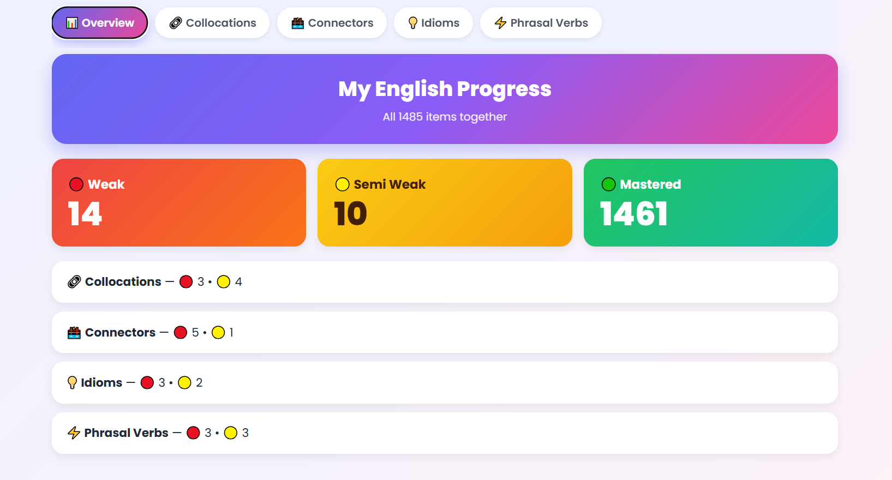
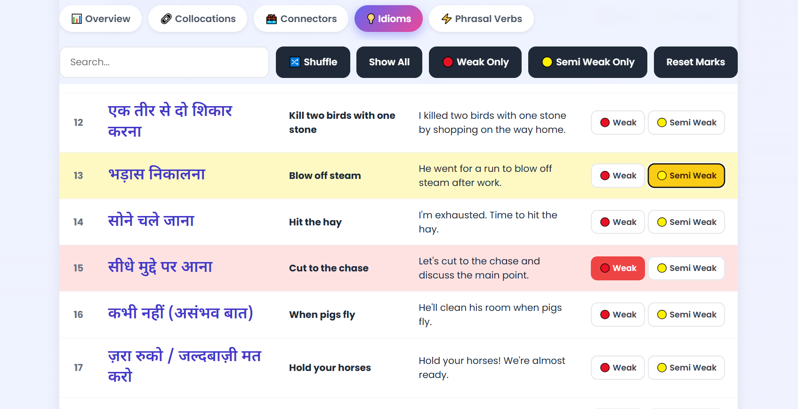

<!-- # 📚 Lexora — English Learning Dashboard

Lexora is a React-based English learning dashboard that helps learners organize and track their progress in English collocations, connectors, idioms, and phrasal verbs. It provides an interactive interface for marking learning levels, searching expressions, and monitoring progress.

## ✨ Features

* 📊 **Progress Dashboard** — View Weak, Semi-Weak, and Mastered item counts.
* 📚 **Four Learning Categories** — Collocations, Connectors, Idioms, and Phrasal Verbs.
* 🔍 **Live Search** — Search expressions by Hindi meaning, English phrase, or example sentence.
* 🎯 **Learning Status Tracking** — Mark expressions as Weak or Semi-Weak.
* 🔄 **Shuffle Words** — Display expressions in a randomized order.
* 🎛️ **Status Filtering** — Filter expressions by learning status.
* 💾 **LocalStorage Persistence** — Keep learning progress after refreshing the browser.
* 📱 **Responsive Interface** — Designed for convenient use across screen sizes.

## 🛠️ Tech Stack

* React
* JavaScript (ES6+)
* CSS3
* LocalStorage
* Create React App / React Scripts

## 🚀 Getting Started

### Prerequisites

* Node.js
* npm

### Installation

1. Clone the repository:

   ```bash
   git clone https://github.com/piyushdhakad001/lexora-english-learning-dashboard
   ```

2. Open the project folder:

   ```bash
   cd lexora-english-learning-dashboard
   ```

3. Install dependencies:

   ```bash
   npm install
   ```

4. Start the development server:

   ```bash
   npm run dev
   ```

5. Open the local URL shown in your terminal, usually `http://localhost:5173`.

## 📂 Project Structure

```text
src/
├── components/
│   ├── Tabs.jsx
│   ├── Overview.jsx
│   ├── Toolbar.jsx
│   └── WordTable.jsx
├── data/
│   └── words.js
├── utils/
│   └── helpers.js
├── App.jsx
├── App.css
└── index.js
```

## 💡 How It Works

1. Select a learning category from the navigation tabs.
2. Search for expressions using Hindi meanings, English phrases, or examples.
3. Mark expressions as Weak or Semi-Weak according to your learning needs.
4. Use filters to focus on expressions that need more practice.
5. Shuffle the word list for a different learning order.
6. Visit the overview dashboard to monitor your learning progress.

Your marks are saved in the browser using LocalStorage, so they remain available after a page refresh on the same browser.

## 🖼️ Screenshots

### Dashboard


### Learning Page



## 🌐 Live Demo

[View Live Demo](https://lexora-english-learning-dashboard.vercel.app/)

## 🎯 Project Goal

Lexora was built to practice React development, component-based architecture, state management, dynamic rendering, search and filtering, and browser-based data persistence.

## 👨‍💻 Author

**Piyush Dhakad**

* GitHub: [Piyush Dhakad](https://github.com/piyushdhakad001)

--- -->

<!-- NEW ONE -->
# 📓 Lexora

> **Lingo Notebook**: a handwritten-style English revision journal. Study collocations, connectors, idioms and phrasal verbs with Hindi meanings, and track what you know. A full-stack app built with React, Vite and Express.


## 🖼️ Screenshots

### Dashboard


### Learning Page


## 🌐 Live Demo

[View Live Demo](https://lexora-english-learning-dashboard.vercel.app/)

---

## ✨ Features

- 📚 **230 study items** across four categories: collocations, connectors, idioms and phrasal verbs
- 🇮🇳 Every item has an **English phrase, a Hindi meaning and an example sentence**
- 🚦 **Progress tracking**: mark items 🔴 Weak or 🟡 Semi Weak (everything else counts as 🟢 Mastered; click again to clear)
- 📊 **Overview dashboard** with totals, mastered percentage and a progress bar per category
- 🔎 **Debounced search** across Hindi, English and examples
- 🔀 **Shuffle** (Fisher-Yates) with a one-click return to the original order
- 🗑️ **Reset all marks** behind a confirmation modal
- 💾 Progress stored on the server, so it survives refreshes and browser changes
- 📝 "Handwritten paper note" visual theme

## 🛠️ Tech Stack

| Layer | Technology |
|---|---|
| Frontend | React, Vite, CSS |
| Backend | Node.js, Express |
| Storage | JSON file (`server/progress.json`) |

## 🧠 Code Highlights

- **Derived state**: dashboard stats are computed from `progress` with `useMemo`, never stored separately
- **Immutable updates**: marks are updated by copying state, not mutating it
- **Performance**: list rows are wrapped in `React.memo`, so only changed rows re-render
- **Custom hooks**: `useDebounce` for search, plus a Fisher-Yates shuffle helper
- **Safe persistence**: progress is only saved after the first load finishes, so saved marks are never overwritten by an empty state

## 🧱 Architecture

```
React + Vite (:5173)  ──/api/progress──▶  Express (:5001)  ──▶  progress.json
```

Only the user's **progress** lives on the server. The word lists are static content kept in `src/data.js`.

Progress shape:

```json
{ "12": "weak", "40": "semi" }
```

An item with no entry is treated as mastered.

## 📁 Project Structure

```
lexora/
├─ server/
│  ├─ index.js          # Express API for progress
│  └─ package.json
├─ src/
│  ├─ App.jsx           # Dashboard, list, modal and app state
│  ├─ data.js           # Categories and study items
│  ├─ hooks.js          # useDebounce, shuffle helper
│  └─ styles.css
├─ vite.config.js       # Dev proxy for /api
└─ package.json
```

## 🚀 Getting Started

### Prerequisites

- [Node.js](https://nodejs.org/) 18 or newer

### Installation

```bash
# 1. Install frontend dependencies
npm install

# 2. Install backend dependencies
cd server
npm install
cd ..
```

### Run the app

```bash
npm run dev
```

This starts both the Vite frontend (`http://localhost:5173`) and the Express server (`http://localhost:5001`) in one terminal.

To run them separately:

```bash
# Terminal 1: frontend
npm run client

# Terminal 2: backend
cd server
node index.js
```

The Vite dev server forwards `/api/*` requests to the backend (configured in `vite.config.js`).

## 🔌 API Reference

| Method | Endpoint | Description |
|---|---|---|
| `GET` | `/api/progress` | Get all saved marks |
| `PUT` | `/api/progress` | Replace all saved marks |

## ⚠️ Known Limitations

- No user accounts: one shared progress file for everyone using the server
- The whole progress object is saved on every change (fine for ~230 items)
- A JSON file is used instead of a real database to keep the backend minimal

## 🗺️ Roadmap

- [ ] Per-user progress with register / login (JWT)
- [ ] Move storage to MongoDB
- [ ] Show an error when saving fails
- [ ] Study modes: weak-only and semi-weak-only filters
- [ ] Deploy (frontend on Vercel, backend on Render)

## 👤 Author

Built by **Piyush** as part of a self-taught journey into full-stack web development.